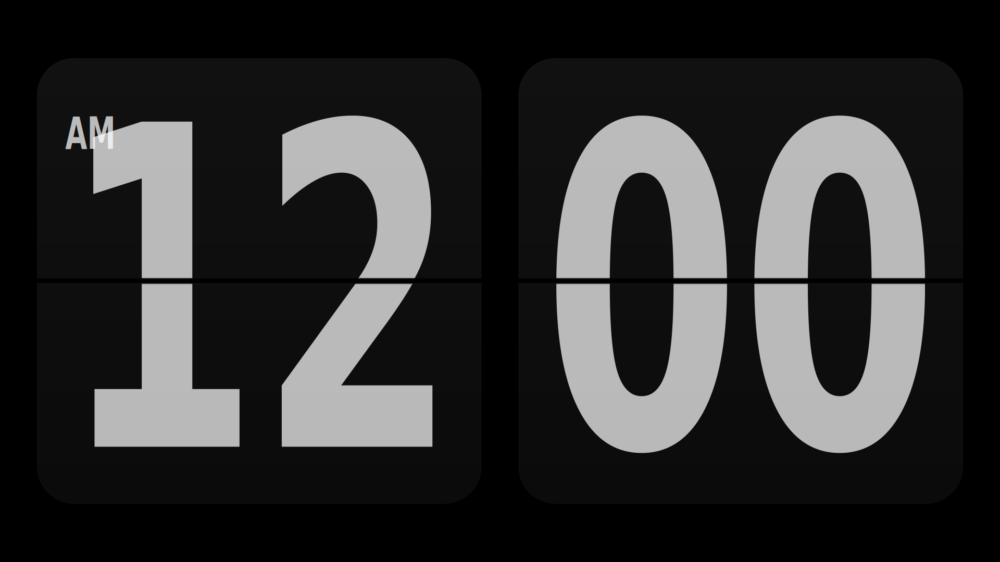
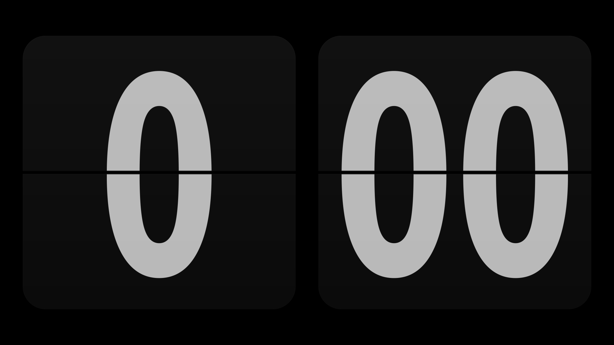
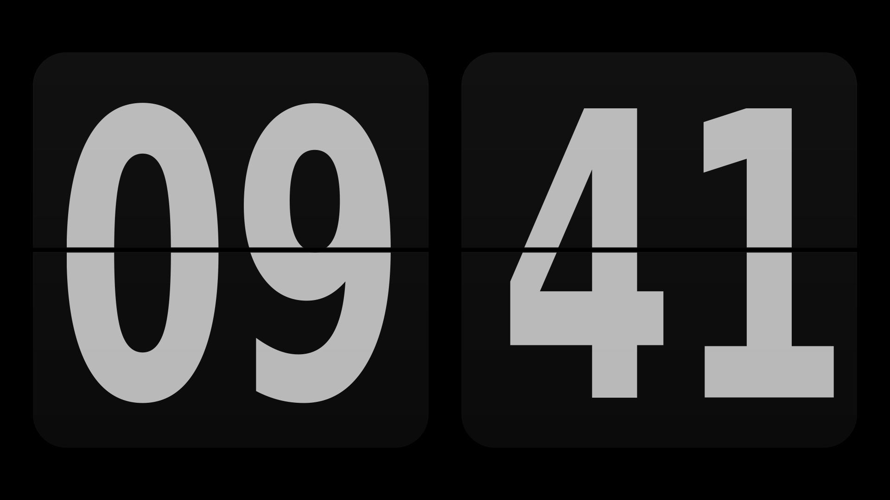
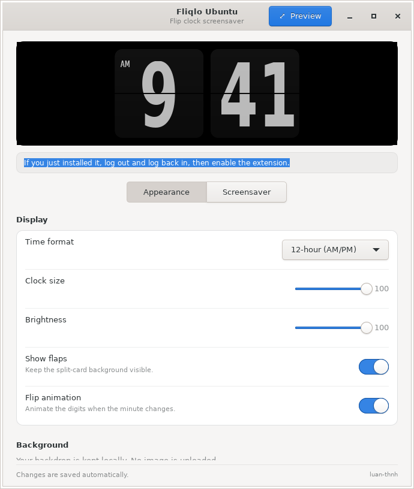
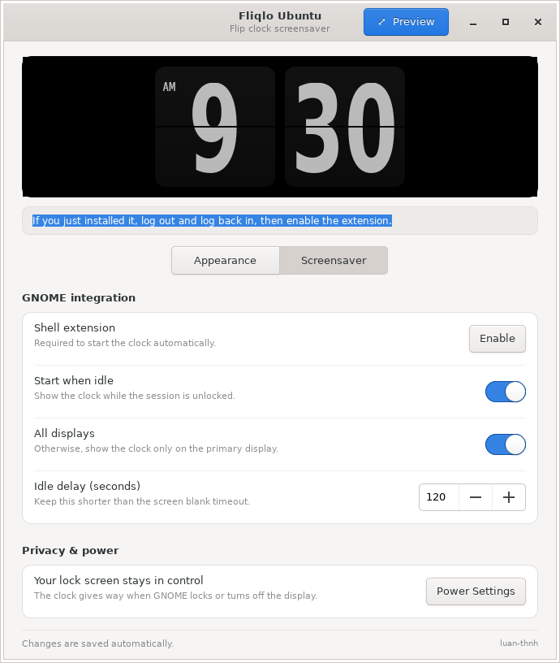
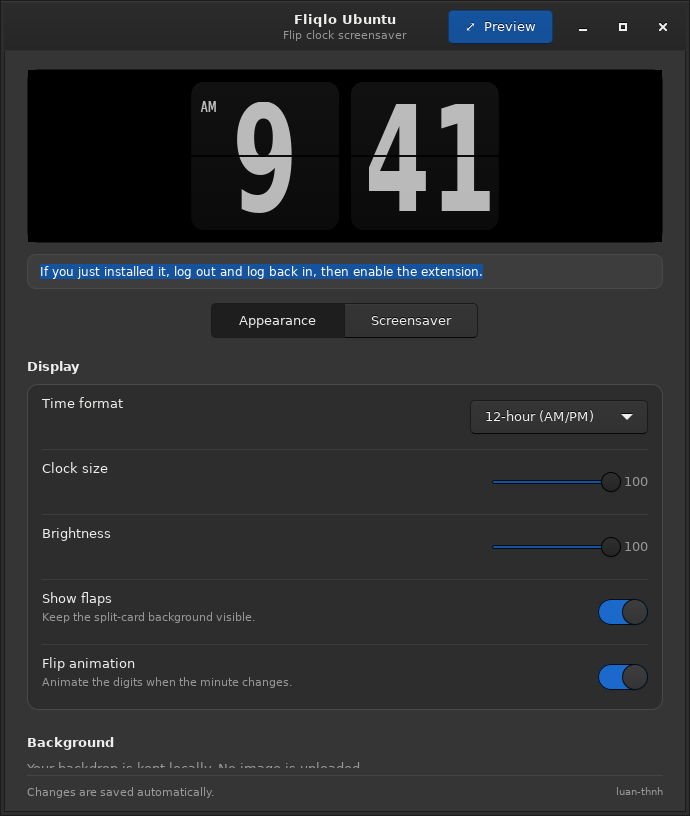
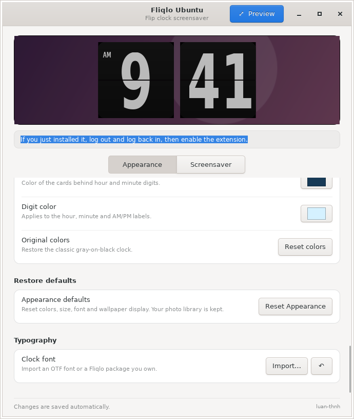

# Fliqlo Ubuntu

**A clean flip-clock screensaver for GNOME on Wayland.**

An independent, open-source-ready implementation of a split-flap clock for Ubuntu. It uses a GNOME Shell extension for idle activation and an optional native GTK app for setup, font import, and fullscreen preview. No browser, Node.js, or background server is required at runtime.

> **Status:** Pre-release 0.4.6 · GNOME Shell **50** / Ubuntu **26.04** target · MIT-licensed original code · maintainer review and real-desktop testing required before GNOME Extensions submission. Not affiliated with Fliqlo or its creator.

## Clock formats

Three **full-resolution** examples rendered by the same Cairo/Pango clock renderer used in the native application. All examples show the same time — **9:41 AM** — so only the formatting changes.

| 12-hour (AM/PM) | 24-hour (0–23) | 24-hour (00–23) |
| :---: | :---: | :---: |
|  |  |  |
| **9:41 AM** | **9:41** | **09:41** |

## Settings

Native GTK preferences captured on Ubuntu with Xvfb. The GNOME Shell extension Preferences UI may differ.

| Appearance · Light | Screensaver · Light | Appearance · Dark |
| :---: | :---: | :---: |
|  |  |  |

### Custom photo library

Add multiple personal backgrounds and pick the active one, or turn on automatic cycling.



*The screenshots use original, temporary gradient samples. Your personal photos stay on your device.*

## Highlights

- Split-flap clock with a 330 ms flip transition and an optional reduced-motion mode.
- Automatic activation while idle, with GNOME's existing lock screen and power policies preserved.
- Native GTK settings with live preview, light/dark theme support, and clear Appearance / Screensaver navigation.
- Extension-native Preferences: edit settings without installing the standalone app.
- 12-hour and two 24-hour formats, adjustable size and brightness, and multi-monitor support.
- Configurable local backdrops: black, solid colors, or a **20-photo library** (PNG/JPEG/WebP), with preview thumbnails, active-image selection, optional timed slideshow, opacity, fit, and dim overlay.
- Optional import of a font from a file **you legally possess**; proprietary Fliqlo assets are not distributed.

## Personalize the background

Open **Appearance → Background → Add photos…** to select up to **20 images at once or across multiple imports** (PNG, JPEG or WebP, max 16 MiB per file). Choose **Use** for the active photo, **Remove** to take it out of the library without deleting the original, or enable **Auto-change photos** and set the interval (10–3600 seconds). You can still adjust **Image opacity**, **Image fit** (Cover, Contain, Stretch, Center), and **Dark overlay**.

The app stores a list of local file URIs in your settings. Nothing is uploaded. Moving or deleting a file makes that background unavailable until you reselect it. The GNOME Shell extension reads the same settings independently from the optional GTK app.

The classic black background remains the default. See [Installation](docs/INSTALLATION.md) for the requirements on GNOME 50/Wayland.

## Install

**Downloads:** Get the latest `.deb` and standalone GNOME extension ZIP from [GitHub Releases](https://github.com/luan-thnh/fliqlo-ubuntu/releases). These are pre-release builds and require testing on a real GNOME 50 desktop.


### GNOME extension (standalone)

Requires GNOME Shell 50 and `glib-compile-schemas` to build the archive:

```bash
sudo apt install libglib2.0-bin zip
./scripts/build-extension.sh
# Archive in dist/fliqlo-ubuntu@luan-thnh-v0.4.6.zip
```

Install the generated archive with the GNOME Extensions app, or use the CLI:

```bash
gnome-extensions install --force dist/fliqlo-ubuntu@luan-thnh-v0.4.6.zip
```

**Log out and back in** on Wayland, then enable the extension in GNOME Extensions. Open **Preferences** to configure it. The standalone app is not required for the screensaver itself.

### Native desktop app + extension (Debian package)

```bash
sudo apt install dpkg-dev libglib2.0-bin
./scripts/build-deb.sh
sudo apt install ./dist/fliqlo-ubuntu_0.4.6_all.deb
```

Log out and back in, open **Fliqlo Ubuntu**, then use **Screensaver → Enable**. Avoid installing both a user-level extension archive and a system-level `.deb` for the same UUID: GNOME may use the user-installed copy instead of the package copy.

See [Installation](docs/INSTALLATION.md) for dependencies, troubleshooting, uninstall instructions, and the live preview.

## Developer quick start

```bash
./run.sh                         # GTK preferences / preview (Ubuntu with GTK 3 dependencies)
node tests/clock.mjs             # Clock logic
node tests/extension-lifecycle.mjs
./scripts/check.sh               # Static checks / tests available on your machine
./scripts/build-extension.sh     # GNOME Extensions release archive
./scripts/build-deb.sh           # Ubuntu .deb package
```

| Directory | Purpose |
| --- | --- |
| [`extension/`](extension/) | GNOME Shell extension, independent Preferences, GSettings schema |
| [`native/`](native/) | Optional GTK desktop settings, clock preview, font import |
| [`packaging/`](packaging/) | Desktop entry and icon |
| [`scripts/`](scripts/) | Build, checks, and reference-comparison tools |
| [`tests/`](tests/) | Clock rendering, lifecycle, and UI tests |
| [`docs/`](docs/) | Installation, architecture, development, and release guides |
| [`research/evidence/`](research/evidence/) | Archived implementation analysis and measurements |

## Compatibility and limitations

The existing rendering code and animation were evaluated on a GNOME 50.1 / Wayland headless environment in the earlier release. Version 0.4.6 changes settings and packaging; it still needs **manual testing** on an actual GNOME 50 desktop, including GPU, HiDPI, multimonitor, extension Preferences, and suspend/lock behavior. It does not replace GNOME's security-sensitive lock screen or inhibit display sleep.

This project is an **independent reimplementation**. It does not ship proprietary Fliqlo binaries, fonts, HTML, or media; see [Third-party acknowledgements](THIRD_PARTY.md). The independently written source is distributed under the [MIT License](LICENSE). Original Fliqlo assets and other third-party material are not included in that grant. Review provenance and contributor permissions before any wider public distribution.

## Documentation

[Installation](docs/INSTALLATION.md) · [Architecture](docs/ARCHITECTURE.md) · [Development and tests](docs/DEVELOPMENT.md) · [Publishing checklist](docs/RELEASING.md) · [Historical research](research/evidence/ANALYSIS.md)

## License

MIT © 2026 luan-thnh — see [LICENSE](LICENSE). Fliqlo is a trademark or product of its respective owner; this project is independent and unofficial.

## Acknowledgements

The original **Fliqlo** screensaver was created by Yuji Adachi / 9031: https://fliqlo.com/. This project is unofficial and not endorsed by the original author.
